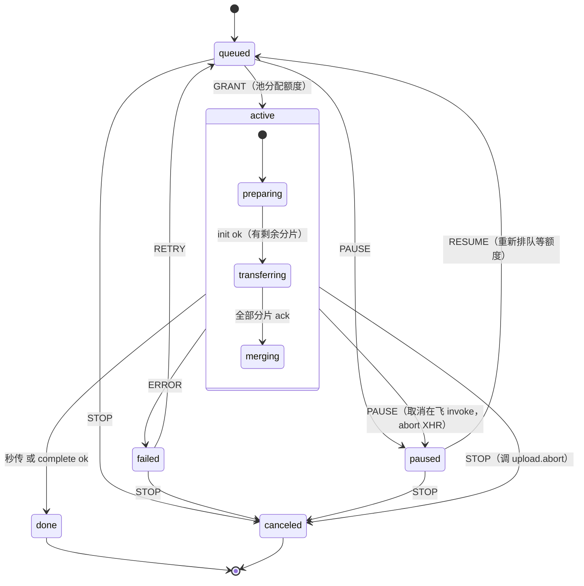

# X1 · P2 上传前端方案调研

|        |                                 |
| ------ | ------------------------------- |
| ID     | `X1`                            |
| 类型   | 调研（一次性消费）              |
| 状态   | 定案（§1–§3 均已落地）          |
| 更新   | 2026-10-15                      |
| 何时读 | P2 实现上传与文件管理（前端）前 |
| 规模   | ~0.9k token                     |

## TL;DR

- **状态机绑定已定（结论记 `D7`）**：`@xstate/solid` 与 `@xstate/store-solid` **均不可用**——见 §1 的三条实测证据。**只用框架无关的 `xstate` v5 核心 + 自持订阅层**。
- **刷新续传载体已定（§2）**：沿用 `A6` §2.2 的**三级阶梯** —— **A（FSA handle，仅 Chromium）/ B（IDB 存 Blob 副本，可暂缓）/ C（仅元数据 + 重选续传，通用兜底）**；本地「已完成分片」永远以服务端 `uploadedParts` 为准。
- **上传状态图已定（§3）**：**每文件机 `uploadItemMachine` + 池编排器 `uploadPoolMachine`**，两个 actor 均挂**模块级**（`D7`）。

## 1. 状态机绑定选型（已定 → `D7`）

`D7` 承诺引 `xstate` 核心、绑定方案待 spike。spike 结论：**官方绑定在本项目不可用**，证据三条：

| #   | 证据                                                                                                                                                                              | 后果                                                                 |
| --- | --------------------------------------------------------------------------------------------------------------------------------------------------------------------------------- | -------------------------------------------------------------------- |
| 1   | `@xstate/solid@2.0.0` peer 声明 `solid-js: ^1.6.0`（`@xstate/store-solid@2.0.1` 为 `^1.7.0`），本项目 `solid-js@2.0.0-rc.7` 不在范围内                                            | 实测安装即报 `warn: incorrect peer dependency "solid-js@2.0.0-rc.7"` |
| 2   | `@xstate/solid` 源码第 2 行 `import { createStore } from 'solid-js/store'`；而 `solid-js@2.0.0-rc.7` 的 `exports` 只有 `.` / `./refresh` / `./package.json`，包内无 `store/` 目录 | **解析失败**（硬错误），不是行为差异                                 |
| 3   | 同文件 `createEffect(fn, true)` 用了 Solid 1.x 的「第二参 = 初始值」，且其 wrapper 逻辑依赖该参判断首帧                                                                           | Solid 2 已移除该参数，即便修好 import，语义也已错位                  |

补充：`createStore` 在 Solid 2 **仍然存在**，但导出位置从 `solid-js/store` 移到了主入口 `solid-js`——所以要"修"就得 fork 该包，不值得。

**结论：不采用官方绑定。** 自持订阅层约 50 行（`actor.subscribe` → `createSignal` → `onCleanup` 退订），成本远低于 fork 维护；收益（状态图、`invoke`、parallel states）全部来自 `xstate` 核心，与绑定无关。

## 2. 刷新续传的持久化载体（定案）

沿用 `A6` §2.2 的**三级阶梯**。本节把每级的**触发条件 / 存储结构 / 降级 / 对账**写死，作为实现依据。

**浏览器事实**（来源见段末）：

- `showOpenFilePicker` 支持面：**Chromium（Chrome / Edge / Opera / Samsung）✅；Firefox ❌；Safari 桌面与 iOS ❌**。
- 权限持久化：Chrome 122+ 引入三向提示（`仅此一次 / 每次访问都允许 / 不允许`）。持久授权需要先 `requestPermission()`，且**必须由用户手势触发**；**同一会话内刷新**（未关闭该 origin 的全部标签）时 `queryPermission()` 通常仍返回 `granted`，可静默恢复；跨浏览器重启的持久续传需用户在恢复 UI 上点一次「恢复访问」。
- IndexedDB 可存 `FileSystemHandle` 与 `Blob`；配额用 `navigator.storage.estimate()` 估算，大对象易触发配额错误。

| 级                    | 触发条件                                                                          | 存什么（IDB）                                                                                         | 刷新后恢复                                                                                                                                  | 降级                     |
| --------------------- | --------------------------------------------------------------------------------- | ----------------------------------------------------------------------------------------------------- | ------------------------------------------------------------------------------------------------------------------------------------------- | ------------------------ |
| **A** · FSA handle    | `'showOpenFilePicker' in window` 且经该选择器选文件                               | `FileSystemFileHandle`                                                                                | 读回 handle → `queryPermission({mode:'read'})`：`granted` 静默续传；`prompt` 在恢复 UI 给「恢复访问」按钮（手势内调 `requestPermission()`） | 权限被拒 / 不支持 → 降 C |
| **B** · IDB Blob 副本 | A 不可用，且 `size ≤ uploadResumeBlobLimit`（默认 200MB）且 `estimate()` 余量充足 | `Blob`（文件副本）+ 元数据                                                                            | 直接读出 `Blob` 续传                                                                                                                        | 超阈值 / 配额不足 → 降 C |
| **C** · 仅元数据      | **通用兜底（默认）**                                                              | 元数据：`fingerprint` / `uploadId` / `name` / `size` / `mtime` / `mime` / `parentId` / `relativePath` | 列表标「继续（需重新选择文件）」；重选后按 fingerprint 匹配 → 走 `upload.init` 同指纹复用，从断点续传                                       | —                        |

**对账（唯一真相）**：本地缓存的「已完成分片」**永远以服务端 `upload.init` 返回的 `uploadedParts` 为准**，本地数据仅用于渲染。队列本身（条目、状态、进度、uploadId、指纹）持久化在 IndexedDB，刷新即重建，再与 `upload.listPending` 对账（`A3` §6）。

**IndexedDB schema**（库 `mydisk-upload`）：

- `sessions`（keyPath `fingerprint`）：`{ fingerprint, uploadId, name, size, mtime, mime, parentId, relativePath, carrier: 'fsa' | 'blob' | 'none', state, updatedAt }`
- `handles`（keyPath `fingerprint`）：`{ fingerprint, handle }` —— 仅 A 级
- `blobs`（keyPath `fingerprint`）：`{ fingerprint, blob }` —— 仅 B 级

**清理**：条目进入 `done` / `canceled` 即删对应 `sessions` 记录，并一并删除 `handles` / `blobs`，避免 IDB 长期占配额。

> 取舍：**B 级（占双份磁盘 + 配额风险）在上传大目录这一主场景下收益最低**，本期可暂缓，非 FSA 浏览器默认走 C（重选续传）——记 `S2` 待确认。
>
> 证据来源：MDN `showOpenFilePicker` 兼容表；Chrome for Developers《Persistent permissions for the File System Access API》。原生选择器无法在自动化环境驱动，故 A 的权限流程以规范为准（未做端到端实测）。

## 3. 上传状态图形状（定案）

两个 actor，**均挂模块级单例**（`D7`：不随组件 / 路由销毁）：

- **每文件机** `uploadItemMachine`：单文件的准备 / 传输 / 合并 / 暂停 / 重试。
- **池编排器** `uploadPoolMachine`：并发额度、排队、全局暂停，持有全部子 actor 的注册表。

### 3.1 每文件机

「继续 = 重新 `init` 拿已传分片 → 从断点续传」（`A6` §2.2），因此**进入 `active` 一律先跑 `upload.init`（幂等）做对账**——这也让 `paused → active` 自然复用同一条路径。

| 状态                  | 含义                                                     | 入口动作                                                       | 关键出口                            |
| --------------------- | -------------------------------------------------------- | -------------------------------------------------------------- | ----------------------------------- |
| `queued`              | 已入队，等池分配并发额度                                 | 登记进池                                                       | `GRANT`→`active`；`PAUSE`；`STOP`   |
| `active`              | 已占用 1 个**文件级**额度（复合态）                      | 入口即 `upload.init`（幂等对账）                               | `done` / `ERROR` / `PAUSE` / `STOP` |
| `active.preparing`    | 算指纹（+ 可选 `sha256`）+ `upload.init`                 | invoke `prepareSession`                                        | → `transferring`；秒传 → `done`     |
| `active.transferring` | 分片泵（文件内并发 ≤ `maxParallelChunks`），失败指数退避 | invoke `chunkPump`（`A3` §6 / §7，走 XHR）                     | → `merging`；`ERROR`                |
| `active.merging`      | `upload.complete` 合并 → `file_node`                     | invoke `finalizeUpload`                                        | → `done`                            |
| `paused`              | 让出额度；保留 `uploadId` 与本地快照                     | 取消在飞 invoke                                                | `RESUME`→`queued`；`STOP`           |
| `failed`              | 终态错误（可重试）                                       | 记录 `error`                                                   | `RETRY`→`queued`；`STOP`            |
| `done` / `canceled`   | 终态                                                     | `done` 触发池释放额度；`canceled` 调 `upload.abort` 并移除条目 | —                                   |

事件：`GRANT`（池 → 条目）/ `PAUSE` / `RESUME` / `STOP` / `RETRY` / 内部 `ERROR` / invoke 完成。

### 3.2 池编排器

- **context**：`maxParallelFiles`（默认 3）、`queue`（FIFO of itemId）、`items`（`Map<id, actorRef>`）、`globalPaused`。
- **调度**：当 `!globalPaused`，且「处于 `active` 的子 actor 数 < `maxParallelFiles`」，且有 `queue` 时出队发 `GRANT`。额度以「`active` 子 actor 计数」实时推导，不单独维护计数器。
- **全局控制**：`PAUSE_ALL` = 置 `globalPaused` + 向所有 `active` 发 `PAUSE`；`RESUME_ALL` = 清标志 + 向所有 `paused` 发 `RESUME`（回 `queued` 后按额度顺序恢复）；`STOP_ALL` = 向所有非终态发 `STOP`；`CLEAR_DONE` = 移除 `done` 条目。
- **注册表**：每个入队项 `spawn(uploadItemMachine, { id, input })`；池订阅子 actor 快照，既驱动调度也供 UI 读取。

### 3.3 落点与接线

- 目录 `apps/web/src/lib/upload/`：`item.machine.ts` / `pool.machine.ts` / `idb.ts` / `store.ts`（薄订阅层）。
- `xstate` 加入 `apps/web` 依赖（`D7`）。
- 组件只在 `onMount` 订阅池快照、`onCleanup` 退订；**上传不因路由切换中断**（同会话刷新后按 §2 恢复）。
- 持久化：`active` / `paused` / `failed` 的关键字段写入 `idb.ts` 的 `sessions`；`done` / `canceled` 触发 §2 的清理。

## 落地清单

- [x] 状态机绑定 spike → 结论见 §1
- [x] 持久化载体定案（沿用 `A6` 三级阶梯；触发条件 / IDB schema / 对账）→ §2
- [x] 定稿状态图形状（每文件机 + 池编排器）并画图 → §3
- [ ] 实现期：`xstate` 加入 `apps/web` 依赖；上传模块落 `apps/web/src/lib/upload/`

## 相关

- 上游：`D7`（决策）、`A3` §6 / §7（接口契约）、`A6`（功能规格）、`A5`（前端规范）、`A4`（存储抽象）
- 未决项 → `S2`
